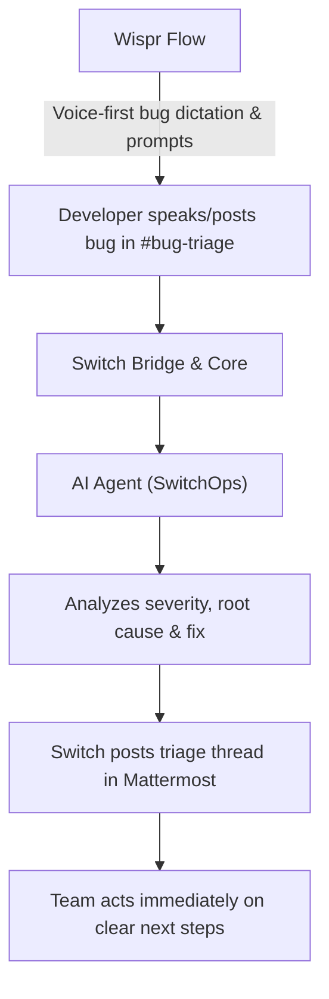
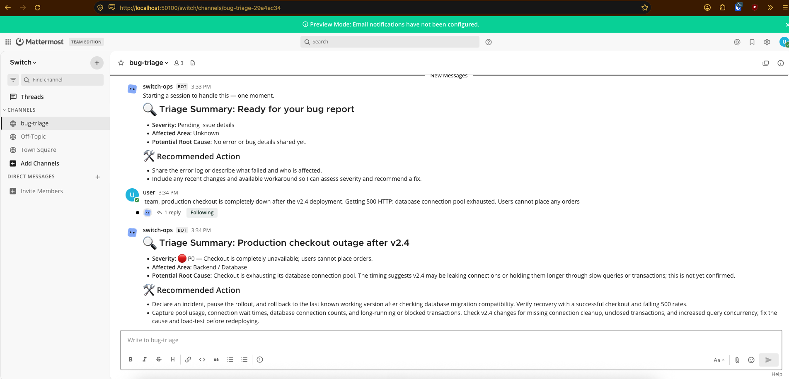
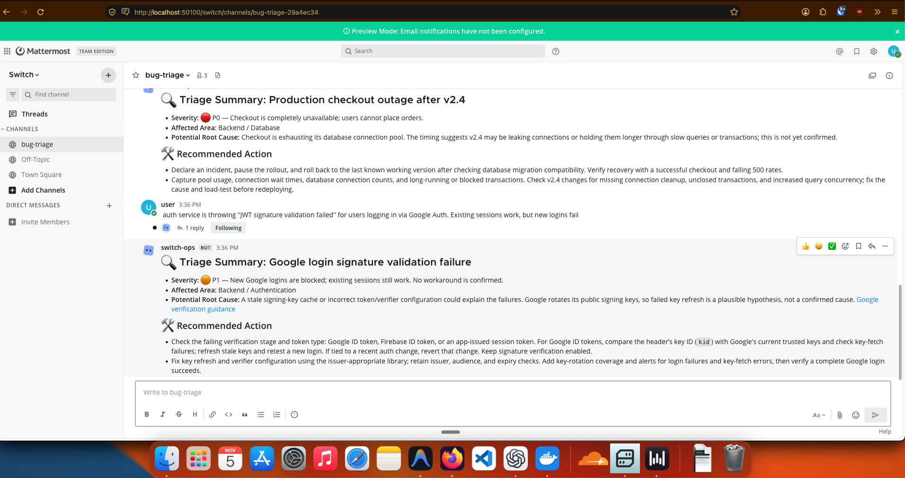
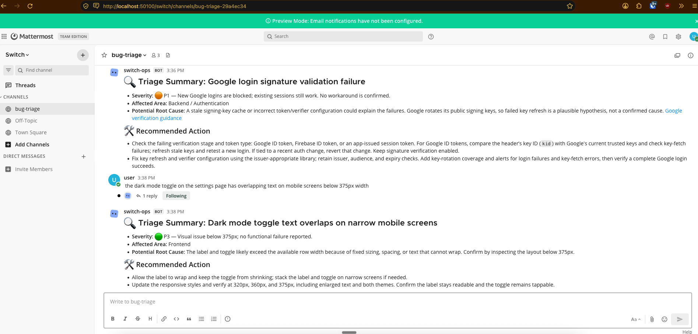
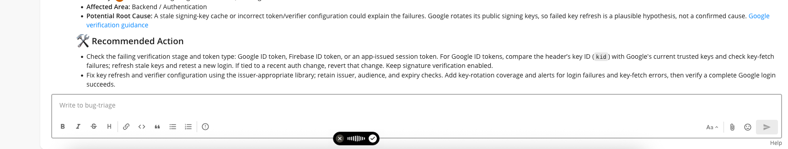
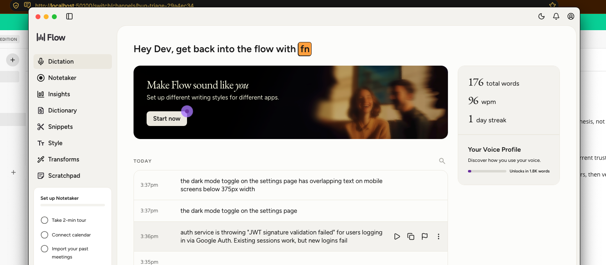

# SwitchOps

> **Turn your solo AI coding agent into an active DevOps teammate in team chat.**  
> Built for the **Flip the Switch Hackathon** hosted by **WeMakeDevs & DevTools Academy**, powered by **Switch AI**.

---

## Overview

Most developers use powerful AI coding agents (Claude Code, OpenCode, Codex, Cursor), but those agents are isolated in private terminal windows. Teammates cannot see their reasoning, collaborate on fixes, or benefit from their analysis in real time.

**SwitchOps** bridges this gap using **Switch AI**. It places an autonomous DevOps & Triage agent directly inside your team chat channels (Mattermost/Slack), enabling:
1. **Instant Bug Triage:** Developers paste bug reports, error logs, or issue links into `#bug-triage`.
2. **Context-Aware Analysis:** The agent assesses severity, highlights root causes, and suggests who on the team should look into it.
3. **Transparent Collaboration:** The entire discussion and triage happens right in the channel thread for the whole team to see.

---

## Architecture



---

## Live Demo and Triage Examples

### 1. P0 Critical Triage - Production Outage
When an outage is reported, SwitchOps immediately identifies the severity, isolates the suspected root cause (connection pool exhaustion after v2.4 rollout), and delivers concrete rollback and debugging instructions:



---

### 2. P1 High Priority Triage - Broken Authentication
A user reports Google OAuth JWT validation failures. SwitchOps pinpoints public key rotation or verifier misconfiguration and advises specific check steps without blocking existing sessions:



---

### 3. P3 Low Priority Triage - Responsive UI Glitch
A minor CSS overlap on mobile screens below 375px is triaged with exact layout fixes:



---

### 4. Built with Wispr Flow (Voice-First DevOps)
Bug reports and prompt engineering were spoken directly using Wispr Flow push-to-talk:



*Wispr Flow Usage & Insights Proof:*


---

## Tech Stack

- **Orchestration & Chat Bridge:** [Switch AI](https://github.com/sandbox-quantum/switch)
- **Chat Environment:** Mattermost (bundled locally via Docker)
- **AI Agent Engine:** Claude / OpenAI / Anthropic CLI agents
- **Voice Dictation:** [Wispr Flow](https://wisprflow.ai) (voice-first prompt engineering)
- **Container Runtime:** Docker Desktop

---

## Quickstart

### Prerequisites
- macOS / Linux / Windows
- [Docker Desktop](https://www.docker.com/) running
- [Switch Console](https://github.com/sandbox-quantum/switch/releases) installed
- [Wispr Flow](https://wisprflow.ai) (optional, for voice dictation)

### Local Setup
1. Clone this repository:
   ```bash
   git clone https://github.com/devprotim/switch-workflow.git
   cd switch-workflow
   ```
2. Open **Switch Console** and complete the `switch-buddy` onboarding.
3. Connect your local Mattermost room `#bug-triage`.
4. Point your AI agent configuration to `agent/system_prompt.md`.
5. Post your first bug report in `#bug-triage`!

---

## Repository Structure

```
switch-workflow/
├── README.md              # Project documentation & architecture
├── DEVLOG.md              # Daily build journey & technical logs
├── agent/
│   ├── system_prompt.md   # Agent role definition and instructions
│   └── triage_rules.json  # Triage severity rules & guidelines
├── demo/
│   └── screenshots/       # Visual proof and demo captures
└── docs/                  # Architecture notes and guides
```

---

## Hackathon Tracks Entered
- **Primary Track:** Best Business Workflow ($2,000)
- **Bonus Track:** Code with Wispr ($500)
- **Bonus Track:** Best Blog (AirPods 5)
- **Bonus Track:** #HowISwitch (Mechanical Keyboard)
